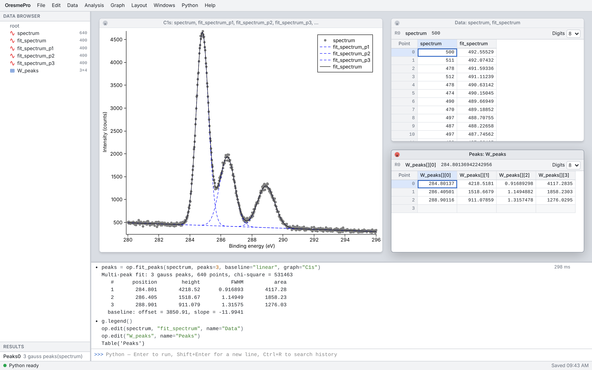

# OresmePro

[](https://github.com/ks250206/OresmePro/actions/workflows/ci.yml)
[](https://github.com/ks250206/OresmePro/releases/latest)
[](https://github.com/ks250206/OresmePro/releases)
[](LICENSE)

<!-- Discord: enable once the server's invite URL and ID are known
[](<DISCORD_INVITE_URL>)
-->
<!-- Remade Stars: enable once the listing page's URL is known
[](<REMADE_STARS_LISTING_URL>)
-->

[日本語](README.md) | English

OresmePro is a scientific data analysis environment that runs in the browser: load experimental data, edit tables, make graphs and analyze them in one workspace.
It follows the feel of WaveMetrics' Igor Pro (waves, graphs, a command window, and every GUI action recorded as a command in the history), with Python as its scripting language.

[](https://ks250206.github.io/OresmePro/)

## Features

- **Nothing to install**: open it in a browser. Python (Pyodide) runs in the browser too, and your data is never sent to a server.
- **Waves at the center**: named arrays with scaling and units, which tables and graphs refer to and follow.
- **An Igor Pro-style workspace**: graphs, tables, a command window, procedures, page layouts and panels.
- **Driven from Python**: what the GUI does, the `op` API does too, and actions are kept as commands in the history. NumPy, SciPy, pandas, lmfit and more are bundled.
- **Analysis**: curve fitting (peaks, global and batch), FFT, smoothing, differentiation and integration, image filters, and more.
- **Loading**: CSV / TSV, Excel, Parquet, HDF5, and Igor files (`.ibw` / `.pxp`).
- **Plugins**: install them from GitHub or a folder; they run in a sandbox.
- **PWA**: install it and use it offline. Experiments are saved in the browser automatically and travel as `.oresme` files.

## Getting started

Just **[open the app](https://ks250206.github.io/OresmePro/)**.
For a first step, see [Your first wave and graph](https://ks250206.github.io/OresmePro/docs/en/getting-started/).

To run it locally, install Node.js and pnpm, run the following, and open the URL it prints.

```sh
pnpm install
pnpm dev
```

## Documentation

Usage, guides and the Python API reference are in the **[documentation](https://ks250206.github.io/OresmePro/docs/en/)** ([日本語](https://ks250206.github.io/OresmePro/docs/)).

- [Getting started](https://ks250206.github.io/OresmePro/docs/en/getting-started/)
- [Guide: graphs](https://ks250206.github.io/OresmePro/docs/en/guides/graphs/)
- [Reference](https://ks250206.github.io/OresmePro/docs/en/reference/)
- [Architecture](https://ks250206.github.io/OresmePro/docs/en/architecture/)

## Development

```sh
pnpm check      # format, lint and type checks
pnpm test       # unit tests
pnpm build      # build into dist/
pnpm e2e        # end-to-end tests (run pnpm build first)
pnpm docs:dev   # dev server for the documentation (docs/)
```

CI is [`.github/workflows/ci.yml`](.github/workflows/ci.yml). Builds of `main` are published to GitHub Pages.

## The name

It is named after **Nicole Oresme**, the 14th-century scholar credited with first drawing a changing quantity as a graph.

## License

[MIT License](LICENSE). Pyodide, NumPy, SciPy and the other packages bundled with the app are under their own licenses.
