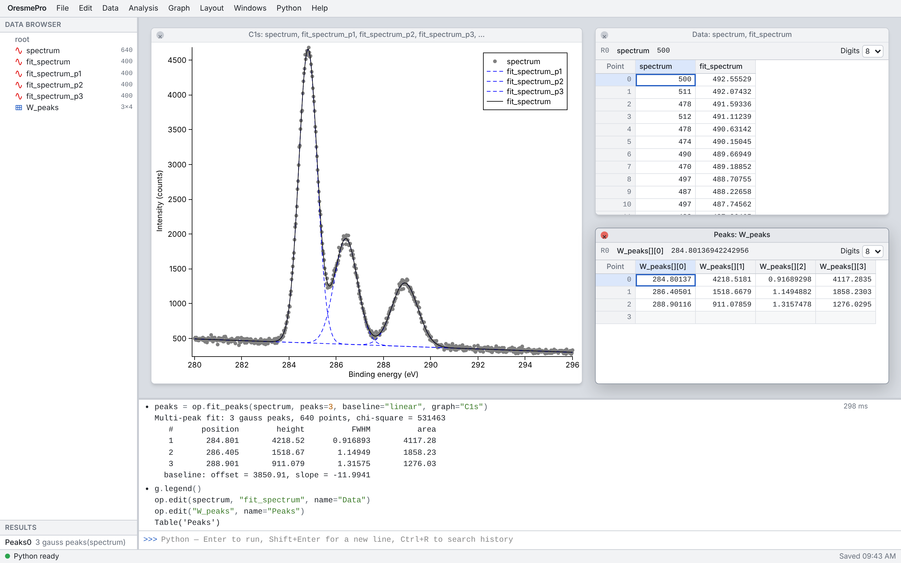

# OresmePro

[](https://github.com/ks250206/OresmePro/actions/workflows/ci.yml)
[](https://github.com/ks250206/OresmePro/releases/latest)
[](https://github.com/ks250206/OresmePro/releases)
[](LICENSE)

日本語 | [English](README.md)

OresmePro は、実験データの読み込み・表編集・グラフ作成・解析を 1 つのワークスペースで行う、ブラウザで動く科学データ解析環境です。
WaveMetrics の Igor Pro の作業感(wave、グラフ、コマンドウィンドウ、GUI 操作がコマンドとして履歴に残ること)を手本に、スクリプト言語には Python を使います。

[](https://ks250206.github.io/OresmePro/)

## 特徴

- **インストール不要**: ブラウザで開くだけで動きます。Python(Pyodide)もブラウザの中で動き、データはサーバーに送られません。
- **wave 中心のデータモデル**: 名前・スケーリング・単位を持つ配列を、表とグラフが参照して追従します。
- **Igor Pro 風のワークスペース**: グラフ、表、コマンドウィンドウ、プロシージャ、ページレイアウト、パネル。
- **Python で操作**: GUI でできることは `op` API からも行え、操作はコマンドとして履歴に残ります。NumPy・SciPy・pandas・lmfit などを同梱しています。
- **解析**: カーブフィット(ピーク・同時・一括)、FFT、平滑化、微積分、画像のフィルタなど。
- **読み込み**: CSV / TSV、Excel、Parquet、HDF5、Igor のファイル(`.ibw` / `.pxp`)。
- **プラグイン**: GitHub やフォルダから入れ、サンドボックスの中で動かします。
- **PWA**: インストールしてオフラインでも使えます。実験はブラウザに自動保存され、`.oresme` ファイルで持ち運べます。

## 使い始める

**[アプリを開く](https://ks250206.github.io/OresmePro/)** だけで使えます。
最初の一歩は [最初の Wave とグラフ](https://ks250206.github.io/OresmePro/docs/getting-started/) を見てください。

手元で動かすときは、Node.js と pnpm を用意して次を実行し、表示された URL を開きます。

```sh
pnpm install
pnpm dev
```

## ドキュメント

使い方・ガイド・Python API のリファレンスは [**公式ドキュメント**](https://ks250206.github.io/OresmePro/docs/) にあります。

- [はじめに](https://ks250206.github.io/OresmePro/docs/getting-started/)
- [ガイド: グラフ](https://ks250206.github.io/OresmePro/docs/guides/graphs/)
- [リファレンス](https://ks250206.github.io/OresmePro/docs/reference/)
- [アーキテクチャ](https://ks250206.github.io/OresmePro/docs/architecture/)

## 開発

```sh
pnpm check      # フォーマット、lint、型チェック
pnpm test       # 単体テスト
pnpm build      # dist/ にビルド
pnpm e2e        # E2E テスト(先に pnpm build が必要)
pnpm docs:dev   # ドキュメント(docs/)の開発サーバー
```

CI は [`.github/workflows/ci.yml`](.github/workflows/ci.yml) です。`main` のビルドは GitHub Pages に公開されます。

## 名前の由来

名前は、変化する量を初めてグラフとして描いたとされる 14 世紀の学者 **ニコル・オレーム**(Nicole Oresme)にちなみます。

## ライセンス

[MIT License](LICENSE) です。同梱して配布する Pyodide、NumPy、SciPy などは、それぞれのライセンスに従います。
