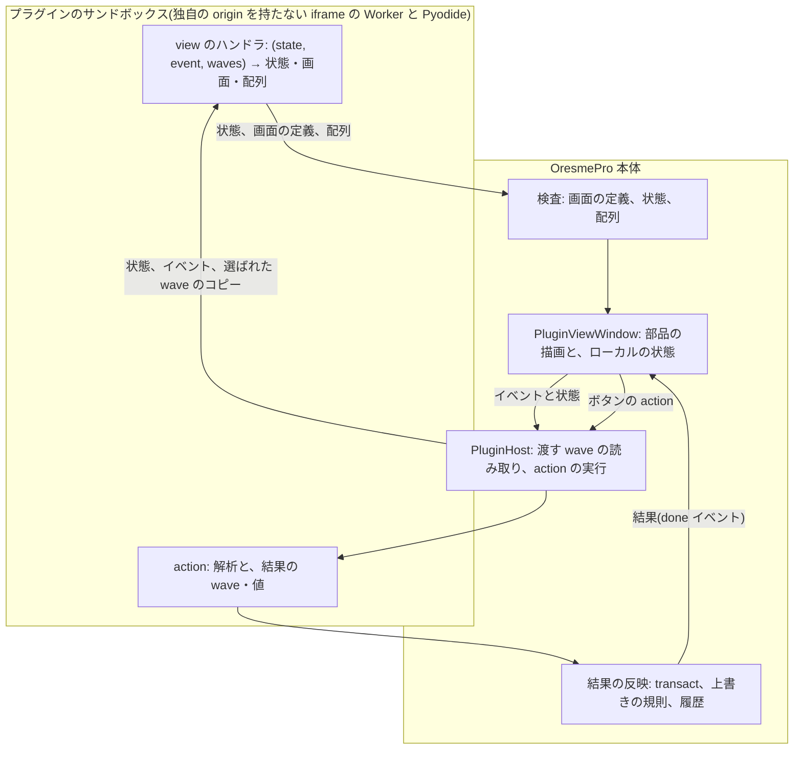

# 設計: 組み合わせて作るプラグインの画面(plugin views)

状態: 実装済み(`src/core/plugins/view.ts`、`src/app/pluginViews.ts`、`src/ui/PluginViewWindow.tsx`、`src/ui/ViewNodes.tsx`、SDK の `view` と `ui`)。第 1 版のあと、プロットのハンドル(§8.1)、ノードと接続の部品(§8.2)、状態の保存(§11)を加えた。検証用の view は `examples/plugins/electrochem/electrochem/view.py`(EIS)と `examples/plugins/xps/xps/quant_view.py`(XPS の定量)
対象: OresmePro の本体と、プラグインの SDK(`src/sandbox/python/oresme_plugin.py`)

## 1. 目的

プラグインの作者が、解析ロジックと一緒に専用の画面を、Python だけで作れるようにする。画面は本体の部品(フォーム、編集できる表、プロット、タブ、ボタンなど)を組み合わせて作り、操作への応答はプラグインの Python が決める。本体は描画、ウィンドウ、入力の検査、データへのアクセスの制御、結果の反映、履歴を受け持つ。

到達目標は、**本体の React に手を入れずに、EIS の等価回路フィットの画面をプラグインだけで作れること**(§15)。

範囲外(後の版で扱う):

- プラグイン自身の HTML/JS で描く画面(webview)(§14)

## 2. 現状と位置づけ

`editors` の `kind: "spectrum-fit"` は、用途を固定した完成品の画面(プリセット)である。データ、範囲、背景の上の項目を、ドラッグと成分の表で編集する。ドラッグの決まりも `items.drag` で宣言でき、XPS のような「ピークを並べてフィットする」解析はこれで足りる。

これとは別に、`kind: "view"` を加える。こちらは画面の構成も操作への応答もプラグインが決める。2 つは並んで存在し、`spectrum-fit` は今後もプリセットとして残す。将来 `view` の部品だけで `spectrum-fit` と同じものが作れるようになれば、`spectrum-fit` を `view` の上に作り直すことも検討する。

## 3. 全体の構成



- 画面の定義は**データ**(JSON)である。本体は知っている部品だけを、検査した props で描く。HTML、JS、式の評価は受け付けない
- プラグインのコードは、今までと同じサンドボックスの中でだけ動く。イベントのたびに本体がハンドラを呼ぶ
- Experiment を変えるのは、ボタンから実行する **action** だけである。結果の反映は、今の action の実行と同じ処理(入力の検査、`transact`、上書きの規則、履歴)を通る

## 4. マニフェスト

```json
"editors": [
  {
    "kind": "view",
    "name": "eis",
    "title": "EIS Circuit Fitting",
    "description": "An equivalent circuit, its parameters, and Nyquist and Bode plots, fitted to a spectrum."
  }
]
```

- `name` は Python で `@view("eis")` として登録する名前と一致させる。読み込み時に、登録の過不足を action と同じく検査する
- `kind` を知らない古いアプリでは、そのプラグインは入れられない(今の規約どおり)
- 画面の中身はマニフェストに書かない。Python が実行時に返す。描けるのは本体の部品だけなので、入れる前に中身を確かめられなくても危険はない。その代わり、インストールの確認画面には「この画面はプラグインの Python が組み立てる」と表示する

## 5. Python の SDK

```python
from oresme_plugin import view, ui

@view("eis")
def eis_view(state, event, waves):
    if event["type"] == "open":
        state = {"frequency": None, "zre": None, "zim": None,
                 "circuit": "R0-p(R1,CPE1)", "params": []}
    ...
    return {
        "state": state,
        "ui": ui.view(
            ui.row(ui.wave("Frequency", "frequency"), ui.wave("Z′", "zre"), ui.wave("−Z″", "zim")),
            ui.split(
                ui.plot([ui.series("nyq_x", "nyq_y", mode="markers", label="Data")], equal=True),
                ui.table("params", [ui.column("name", "Parameter", editable=False),
                                    ui.column("value", "Value", type="number")]),
            ),
            ui.button("Fit", action="eis_circuit", args={...}, replace=True, primary=True),
        ),
        "waves": {"nyq_x": wave(...), "nyq_y": wave(...)},
    }
```

- ハンドラは `(state, event, waves)` を受け取り、`state`・`ui`・`waves`・`message` を含む dict を返す。`state`・`ui`・`message` を省くと、本体は前の値を使い続ける。`waves` は毎回その返事で描くものだけになる(省けば何も描かない)
- `state` は JSON にできる値(dict が基本)。本体が保持し、毎回ハンドラに渡す。ハンドラ自身は何も覚えない(サンドボックスが作り直されても続けられる)
- `waves` は、画面の `wave` 部品で選ばれた wave の**コピー**で、キーはその部品の `bind` の道筋である。それ以外のデータは渡さない
- 返す `waves` は、プロットが役割の名前で参照する配列である。Experiment には入らない
- `ui.*` は画面の定義の dict を作るだけの関数である。手で dict を書いてもよい

## 6. イベント

本体がハンドラに渡す `event`:

| 型        | 中身                                                                                                                                                                                            | いつ                                                                                                                                   |
| --------- | ----------------------------------------------------------------------------------------------------------------------------------------------------------------------------------------------- | -------------------------------------------------------------------------------------------------------------------------------------- |
| `open`    | `saved`: Experiment に残っていたこの画面の状態 `{state, version}`(§11)。`last`: このプラグインが最後に残した結果(`action`、`inputs`、`params`、`names`、`coef`、`sigma`)。どちらもなければ null | 画面を開いたとき。ハンドラが状態の中で wave を選び直したら(前の結果から戻したときなど)、本体はその wave を付けて続けて `change` を送る |
| `change`  | `paths`: 変わった `bind` の道筋のリスト。ウィンドウの中で元に戻したときは `"*"`                                                                                                                 | 部品で値が変わったとき。状態はもう新しい値になっている                                                                                 |
| `command` | `id`: ボタンの `on`、またはプロットの `on_click`(このときは押した位置 `x`・`y` も)                                                                                                              | `on` を持つボタンが押されたとき                                                                                                        |
| `done`    | `id`、`args`(実行したときの引数。今の画面と同じものへの結果かを確かめるため)、`ok`、`values`(action が返した値)、`result`(残した結果の名前)、`error`                                            | `action` を持つボタンの実行が終わったとき                                                                                              |

## 7. 状態の持ち方と操作感

| 状態                   | 持つところ                                   | 例                                                     |
| ---------------------- | -------------------------------------------- | ------------------------------------------------------ |
| 表示だけの一時的な状態 | 本体                                         | ホバー、選択中のタブ、入力途中の文字、ドラッグ中の位置 |
| 編集中のモデル         | 本体が持ち、イベントのたびにプラグインと共有 | 回路、パラメータ、設定                                 |
| 描くための配列         | プラグインが計算し、本体が表示               | モデルの曲線、残差                                     |
| 確定した結果           | Experiment                                   | 出力 wave、グラフ、結果、履歴                          |

- 入力部品の値は、本体がすぐローカルの状態に書き込んで描き直す。返事を待たない
- ハンドラへの要求は 1 つずつ送る。返事を待つ間の `change` は 1 つにまとめ(`paths` の和)、最新の状態で次に送る。`command` は順に送る
- 返ってきた状態は、まだ送っていないローカルの変更(値の変更、元に戻す・やり直すによる状態ごとの置き換え)を、した順に上に重ねて使う。各要求には連番 `revision` を付け、古い返事は捨てる
- 1 回のハンドラ呼び出しは 30 秒まで。超えたらサンドボックスを作り直し、画面には失敗を表示する

## 8. 部品

画面の定義は `{"version": 1, "body": 部品}` で、部品は `{"type": ..., ...}` である。

| 型              | props                                                                                                                                         | 説明                                                        |
| --------------- | --------------------------------------------------------------------------------------------------------------------------------------------- | ----------------------------------------------------------- |
| `column`, `row` | `children`, `gap`                                                                                                                             | 縦・横に並べる                                              |
| `split`         | `children`(2 つ), `direction`(`horizontal`/`vertical`), `ratio`(0.1–0.9)                                                                      | 2 つに分ける                                                |
| `tabs`          | `tabs`: `[{title, body}]`                                                                                                                     | タブ                                                        |
| `group`         | `title`, `body`                                                                                                                               | 見出し付きの枠                                              |
| `text`          | `text`, `tone`(`normal`/`muted`/`danger`/`success`), `mono`                                                                                   | 文字                                                        |
| `number`        | `label`, `bind`, `min`, `max`, `step`, `unit`                                                                                                 | 数値                                                        |
| `string`        | `label`, `bind`, `placeholder`, `suggestions`                                                                                                 | 文字列                                                      |
| `choice`        | `label`, `bind`, `choices`(値、または `[表示, 値]`)                                                                                           | 選択                                                        |
| `checkbox`      | `label`, `bind`                                                                                                                               | 真偽                                                        |
| `wave`          | `label`, `bind`, `optional`                                                                                                                   | 1 次元の数値 wave を選ぶ。値は wave の名前か null           |
| `table`         | `bind`(行の dict のリスト), `columns`: `[{key, title, type, choices, editable, width}]`, `add`, `remove`                                      | 編集できる表。`type` は `text`/`number`/`checkbox`/`choice` |
| `plot`          | `series`: `[{x, y, mode, color, label}]`, `x_label`, `y_label`, `x_log`, `y_log`, `equal`, `x_reverse`, `height`, `handles`(§8.1), `on_click` | 返された配列(役割の名前)の折れ線・点                        |
| `button`        | `label`, `on` か `action`(どちらか), `args`, `replace`, `primary`, `disabled`                                                                 | ハンドラを呼ぶか、action を実行する                         |
| `nodes`         | `label`, `bind`, `palette`: `[{kind, title, ports, color, add}]`, `height`                                                                    | ノードと接続の図を編集する(§8.2)                            |

- `bind` は状態の中の道筋で、ドット区切り(`params.2.value` のように数字はリストの添字)
- `button` の `args` の値は、JSON の値そのものか `{"$bind": "道筋"}`(状態のその値)

### 8.1 プロットのハンドル

`plot` の `handles` は、ドラッグできる印のリストで、各々 `{x, y, bind_x, bind_y, label, color}` である(最大 200)。

- `x` と `y` はプロットの単位での位置。両方あれば点、`y` がなければ縦の線、`x` がなければ横の線になる
- `bind_x`・`bind_y` は状態の道筋で、ハンドルはその向きにだけ動く。どちらもなければ動かない印(他の領域の境など)
- ドラッグ中は本体が動かす。ハンドルは指の下に描き、プロットの尺度は離すまで固定する。動いた分だけ、束ねた値を変える: 線形の軸では差を足し、対数の軸では比を掛ける。位置と値が同じものである必要はない(背景の上の高さ、など)
- 値の変化はふつうの `change`(`paths` は束ねた道筋)としてハンドラに伝わり、返事を待つ間の変化は 1 つにまとまる(§7)。ドラッグ 1 回は、元に戻す 1 回である
- `on_click` はハンドラの名前で、ハンドルから離れた所を(動かさずに)押すと、`{"type": "command", "id": ..., "x": ..., "y": ...}` を送る。点を足す、領域を足す、などに使う

`spectrum-fit` のドラッグの決まり(`items.drag`)は、ハンドルの位置と束ねる値を Python が決めれば同じことができる。`spectrum-fit` を `view` の上に作り直すときの土台になる。

### 8.2 ノードと接続の部品

`nodes` は、箱(ノード)とその端子(ポート)を線(エッジ)でつないだ図を編集する。`bind` の値は次の形で、図の意味(回路、処理の流れなど)は本体は知らない。

```json
{
  "nodes": [{ "id": "R0", "kind": "R", "label": "R0", "x": 100, "y": 40, "fixed": false }],
  "edges": [{ "from": ["start", "p"], "to": ["R0", "a"] }]
}
```

- `palette` はノードの種類で、`ports` は端子の名前(左右に交互)か `[名前, 向き]`(`left`/`right`/`top`/`bottom`)。`add: false` の種類はパレットに出ず、Python だけが作る(回路の両端など)
- パレットのボタンで足すノードの id は、種類と使われていない最小の番号(`R0`、`R1`、…)。位置は空いている所
- ノードはドラッグで動かし(10 px の格子)、端子から端子へドラッグしてつなぐ。選んだノードかエッジは Delete か Remove で消す(エッジも一緒に消える)。`fixed` のノードは消せない
- どの編集も `bind` の値を丸ごと置き換える 1 回の変更で、元に戻す 1 回になる。本体は読めないノードやエッジを捨てて描くが、状態そのものは書き換えない
- 上限は描くとき: ノード 500、エッジ 2000、種類 40、端子 8

EIS の view は、回路の文字列と図を両方向に結ぶ。文字列が変わると図を並べ直し(図がすでにその回路なら並べ直さない)、図が変わると、直列(2 つだけが出会う点)と並列(同じ 2 点の間)をまとめていって 1 つの回路の文字列にする。まとめられない図(ブリッジ、どこにもつながらない端子)は、理由を `message` に出し、回路は前のままにする。

## 9. ボタンから action を実行する

- `action` は**同じプラグイン**の action の名前に限る
- 本体は `args` を状態から組み立て、今の action の実行と同じ検査(引数の型、wave の存在)をし、`invokeAction` で実行する。履歴には `op.invoke("plugin.<名前>.<action>", {...}, replace=True)` として残る
- `replace` が真なら §10 の上書きの規則で実行する
- 終わったら `done` イベントでハンドラに知らせる。ハンドラは、求まった値を状態に入れるなどして画面を更新する

## 10. 上書き・undo・履歴

今の規則を変えない。

- action の結果は新しい名前の wave になり、既存の wave を置き換えない
- `replace=True` なら、同じプラグインの同じ action が同じ入力 wave で前回作った wave のうち、その後変わっていないものだけを同じ名前で作り直し、そのグラフも更新する。決めるのは本体と使う人で、プラグインではない
- Experiment の undo は action の実行単位。画面の中の編集の undo は、本体が状態の履歴として持つ(`spectrum-fit` と同じ Ctrl+Z)。部品での編集のほか、`command`(ボタン、プロットのクリック)や `done` への返事が状態を変えたときも、1 回の undo になる
- プラグインを外しても、作った wave・グラフ・結果は本体の形式のまま残る

## 11. 保存

画面の状態は Experiment の `editors` に、`"<プラグイン>/<画面>"` ごとに `{plugin, editor, version, state}` として保存する(`.oresme` にも入る)。`version` は保存したときのプラグインの版で、プラグインのコードとは分けて持つ。`spectrum-fit` の画面も同じ所に、データごとの領域・設定・項目と報告を保存する。

- 状態が変わって 0.4 秒たつと、本体が `keepEditorState` で書き込む(ドラッグの一歩ごとには書かない)。ページが隠れるか離れるときは待たずに書き込み、そのあと Experiment が保存される(`src/app/editorMemory.ts`)。Experiment の元に戻す対象ではなく(ノートの本文と同じ)、履歴にも残らない。画面の中の元に戻すは今までどおり
- 開き直すと、`open` イベントの `saved` で渡す。古い版の状態をどう読むか(読めない所を捨てる、移し替える)はハンドラが決める。`saved` がないときは `last` から作り直せる
- 保存できるのは JSON で 1 MiB まで。読めないもの(名前が不正、大きすぎる)は、ファイルを開くときに捨て、他は開く
- 別の Experiment を開くと、開いている画面を閉じ、本体が覚えている状態も捨てる
- プラグインを外しても、保存した状態は残る(入れ直せば続きから)

## 12. 版

- 画面の定義には `version` を付ける。本体は知っている版だけを受け付ける。部品や props を足すのは同じ版のまま後方互換で行い、意味を変えるときは版を上げる
- 本体の React の作りは公開しない。Python が知るのは部品の型と props だけである

## 13. 検査・上限・権限

| 対象           | 上限・規則                                                                                                      |
| -------------- | --------------------------------------------------------------------------------------------------------------- |
| 画面の定義     | 部品 2000 個、入れ子 32 段、文字列 4000 字、ラベル 200 字。知らない型・props は全体を拒否し、画面には理由を出す |
| 状態           | JSON で 1 MiB、入れ子 32 段                                                                                     |
| 返す配列       | 今の実行と同じ上限(64 個、合計 5000 万点)                                                                       |
| 表             | 2000 行、40 列                                                                                                  |
| プロット       | 系列 32 本、ハンドル 200 個                                                                                     |
| ノードの図     | 種類 40、端子 8。描くのはノード 500、エッジ 2000 まで                                                           |
| 保存する状態   | JSON で 1 MiB                                                                                                   |
| 渡すデータ     | `wave` 部品で選ばれた wave のコピーだけ。wave の一覧は本体だけが持ち、プラグインには渡さない                    |
| 実行できるもの | 自分の action だけ。上書きは §10 の規則を満たすものだけ                                                         |
| 通信・保存     | なし(今のサンドボックスのまま)                                                                                  |

- 色は `#rrggbb` か決まった名前だけ。URL、画像、リッチテキストは第 1 版では扱わない
- 文字はすべてテキストとして描く(HTML として解釈しない)

## 14. 将来の拡張

1. `spectrum-fit` を、ハンドル(§8.1)を使った `view` の上に作り直す
2. 部品で表せない画面のための webview。今の計算用サンドボックス(DOM を持たない Worker)とは別に、権限と通信を設計し直す

(第 1 版で挙げていたプロットのハンドルとノードの部品は §8.1・§8.2 で実装した。ハンドルは、移動ごとの `handle` イベントではなく、状態の値に束ねる形にした。ハンドラは状態の変化として受け取れば足り、本体だけで動かせるため)

## 15. 検証: EIS の等価回路フィット

electrochem プラグインに、本体の React に手を入れずに `view` を加える。

- 上段: 周波数、Z′、Z″ の wave、回路の文字列(よく使う回路の候補付き)、虚部の向き
- 左: Nyquist(Z′ と −Z″、縦横同じ尺度)と Bode(|Z| と位相、周波数は対数)。データは点、今のパラメータでのモデルは線
- 右: パラメータの表(名前、値)。回路を変えると行が作り直され、同じ名前のパラメータは値を引き継ぐ
- ボタン: 初期値の推定(`command`)、Fit(`eis_circuit` を `replace=True` で実行し、求まった値を表に戻す)
- 値を変えるたびにモデルの曲線を描き直す

これを満たすのに必要な本体の部品は §8 の第 1 版に含めている。

その後の拡張は、次で確かめている。

- EIS の view の **Diagram** タブ: 回路を `nodes` 部品の図として描き、図を描き換えると回路の文字列とパラメータの表が追いかける(§8.2)
- xps プラグインの view **XPS Quantification**(`quant`): 領域の境を縦線のハンドルとしてドラッグし(§8.1)、スペクトルを押して領域を足し(`on_click`)、面積と原子 % をその場で出す。Quantify で action `quantify` を `replace=True` で実行する
- どちらの画面も、状態を Experiment に保存し、再読み込みのあと残したところから開く(§11)
