## React と Experiment の状態

`src/App.tsx` がメニュー、Data Browser、デスクトップ、コマンドウィンドウを組み立てます。`src/app/session.ts` は Doc、履歴、ファイルストアと Python カーネルを接続します。`src/core/doc/` の Doc が Experiment の状態を管理します。画面と Python の変更はコマンドとして Doc に適用され、React はストアを購読して再描画します。

## Pyodide、IPython、同期 RPC

`src/kernel/client.ts` が Web Worker を起動し、実行要求を送ります。`src/kernel/worker.ts` は Pyodide と Python モジュールを読み込み、`oresme_kernel.py` の IPython シェルで入力を実行します。出力はメッセージでメインスレッドへ返り、履歴に表示されます。

`op.make` などの呼び出しは、Worker からメインスレッドへ RPC 要求を送ります。Worker は共有バッファ上で `Atomics.wait` し、`src/kernel/rpc.ts` が Doc の読み書きを処理します。応答の JSON と必要に応じた数値データがバッファに書かれ、`Atomics.notify` で Worker が再開します。応答が収まらない場合は、バッファを拡張して応答を再送します。

## SharedArrayBuffer とクロスオリジン分離

同期 RPC と割り込みには `SharedArrayBuffer` が必要です。Vite の開発・プレビューサーバーは `Cross-Origin-Opener-Policy: same-origin` と `Cross-Origin-Embedder-Policy: require-corp` を返します。ヘッダーを設定できない静的ホストでは、アプリの Service Worker が応答に付与します。初回起動時に Service Worker の有効化後、アプリが1回再読み込みされることがあります。

## Wave とグラフ描画

数値 Wave は形状、スケーリング、単位、型と型付き配列を持ちます。複素数の虚部は別の配列に保持し、テキスト Wave は文字列を保持します。グラフとテーブルは名前で Wave を参照します。Python の `Wave` は Doc 側のデータにアクセスするためのハンドルです。

`src/core/plot/` は軸スケール、目盛り、トレース、画像・等高線、注釈から描画命令を組み立てます。画面描画には Canvas を使い、同じ描画命令を SVG・PDF や PNG の書き出しにも利用します。

## OPFS による保存

`src/app/persist.ts` はブラウザーの Origin Private File System にデータとインデックスを保存し、再読み込み時に復元します。Wave の配列は NPY 形式で保存され、インデックスが関連ファイルを参照します。現行の保存とバックアップを管理し、対応ブラウザーでは Web Locks を使って同時に保存するタブを調整します。持ち出し用の `.oresme` は関連データをまとめた ZIP 形式です。

[アプリのソース](https://github.com/ks250206/OresmePro/tree/main/src) · [Mermaid 図のソース](https://github.com/ks250206/OresmePro/blob/main/docs/diagrams/architecture.mmd)
