## React and experiment state

`src/App.tsx` assembles the menus, Data Browser, desktop, and Command Window. `src/app/session.ts` connects the Doc, history, file store, and Python kernel. The Doc in `src/core/doc/` owns experiment state. Both UI actions and Python calls apply commands to the Doc. React subscribes to stores for updates.

## Pyodide, IPython, and synchronous RPC

`src/kernel/client.ts` starts the Web Worker and sends execution requests. `src/kernel/worker.ts` loads Pyodide and the Python modules. The IPython shell in `oresme_kernel.py` runs the input. Output returns to the main thread as messages and appears in the command history.

A call such as `op.make` sends an RPC request from the worker to the main thread. The worker waits on a shared buffer using `Atomics.wait`. The handler in `src/kernel/rpc.ts` reads or updates the Doc. The response contains JSON and optional numeric data. The main thread writes it to the buffer and wakes the worker with `Atomics.notify`. If the response is too large, the worker grows the buffer and requests the same response again.

## Changes that go in together

An operation made of several commands is applied entirely or not at all. `Doc.transact()` applies the commands to a working state and replaces the document's state once at the end. Because `applyCommand` is a pure function returning immutable state, a failure only discards the working state. Interface actions use it.

Python's `op.atomic()` is the same mechanism spread over many RPC requests. While a block is open, `src/kernel/rpc.ts` directs reads and writes to a `Stage` instead of the document. When the block ends, the stage replays its commands on the document as the interface left it meanwhile. It refuses if a wave the block read has a different `rev`: revisions are unique across all waves and never reused, so an unchanged `rev` means unchanged content.

## Actions: calls by name with typed arguments

The interface, templates, and plugins call analyses through actions. An analysis is defined only by its Python function; `@op.action` registers it with a name, a version, and the types of its arguments. The main thread sends `{type: "invoke", action, version, argsJson}` to the worker with `KernelClient.invoke()`. The call is queued like an execution: Python looks the action up, checks the arguments, calls the function inside `op.atomic()`, and returns the result as JSON. No code string is built or run.

The history records the equivalent call that Python writes, such as `op.fit("gauss", op.wave("signal"))`. Python sends the list of actions to the main thread when it starts and whenever it changes. The argument types, and the check a GUI runs before sending, are in the DOM-free `src/core/actions.ts`.

An analysis template is data: a list of steps, each an action and its arguments. Templates and run records live in the Doc as `templates` and `runs` and change through commands like everything else; `src/core/doc/analysisTemplates.ts` checks the shape and order of references when one is saved. Python, which holds the catalog of actions, runs them (`core.run_template`): each sample's steps run inside one `op.atomic()` block, and the sample's record goes in with its outputs when it finishes. The interface sees a run progress, and a sample that fails leaves nothing behind.

## SharedArrayBuffer and cross-origin isolation

Synchronous RPC and interruption require `SharedArrayBuffer`. The Vite development and preview servers return `Cross-Origin-Opener-Policy: same-origin` and `Cross-Origin-Embedder-Policy: require-corp`. On static hosts without configurable headers, the app's service worker adds them to responses. The app can reload once on first launch after the service worker activates.

## Wave model and graph rendering

A numeric wave stores shape, scaling, units, type, and a typed array. Complex waves hold a separate imaginary array, and text waves hold strings. Graphs and tables refer to waves by name. A Python `Wave` is a handle to the data owned by the Doc.

`src/core/plot/` creates drawing commands from scales, ticks, traces, images, contours, and annotations. The workspace renders these commands on Canvas and reuses them for SVG, PDF, and PNG export.

## OPFS persistence

`src/app/persist.ts` saves data and indexes to the browser's Origin Private File System and restores them on reload. Wave arrays are saved as NPY files, with indexes referring to the associated files. The persistence layer keeps current and backup state, using Web Locks where available to coordinate saves between tabs. A portable `.oresme` file packages related data as a ZIP archive.

[App source](https://github.com/ks250206/OresmePro/tree/main/src) · [Mermaid diagram source](https://github.com/ks250206/OresmePro/blob/main/docs/diagrams/architecture.mmd)
