## React and experiment state

`src/App.tsx` assembles the menus, Data Browser, desktop, and Command Window. `src/app/session.ts` connects the Doc, history, file store, and Python kernel. The Doc in `src/core/doc/` owns experiment state. Both UI actions and Python calls apply commands to the Doc. React subscribes to stores for updates.

## Pyodide, IPython, and synchronous RPC

`src/kernel/client.ts` starts the Web Worker and sends execution requests. `src/kernel/worker.ts` loads Pyodide and the Python modules. The IPython shell in `oresme_kernel.py` runs the input. Output returns to the main thread as messages and appears in the command history.

A call such as `op.make` sends an RPC request from the worker to the main thread. The worker waits on a shared buffer using `Atomics.wait`. The handler in `src/kernel/rpc.ts` reads or updates the Doc. The response contains JSON and optional numeric data. The main thread writes it to the buffer and wakes the worker with `Atomics.notify`. If the response is too large, the worker grows the buffer and requests the same response again.

## SharedArrayBuffer and cross-origin isolation

Synchronous RPC and interruption require `SharedArrayBuffer`. The Vite development and preview servers return `Cross-Origin-Opener-Policy: same-origin` and `Cross-Origin-Embedder-Policy: require-corp`. On static hosts without configurable headers, the app's service worker adds them to responses. The app can reload once on first launch after the service worker activates.

## Wave model and graph rendering

A numeric wave stores shape, scaling, units, type, and a typed array. Complex waves hold a separate imaginary array, and text waves hold strings. Graphs and tables refer to waves by name. A Python `Wave` is a handle to the data owned by the Doc.

`src/core/plot/` creates drawing commands from scales, ticks, traces, images, contours, and annotations. The workspace renders these commands on Canvas and reuses them for SVG, PDF, and PNG export.

## OPFS persistence

`src/app/persist.ts` saves data and indexes to the browser's Origin Private File System and restores them on reload. Wave arrays are saved as NPY files, with indexes referring to the associated files. The persistence layer keeps current and backup state, using Web Locks where available to coordinate saves between tabs. A portable `.oresme` file packages related data as a ZIP archive.

[App source](https://github.com/ks250206/OresmePro/tree/main/src) · [Mermaid diagram source](https://github.com/ks250206/OresmePro/blob/main/docs/diagrams/architecture.mmd)
