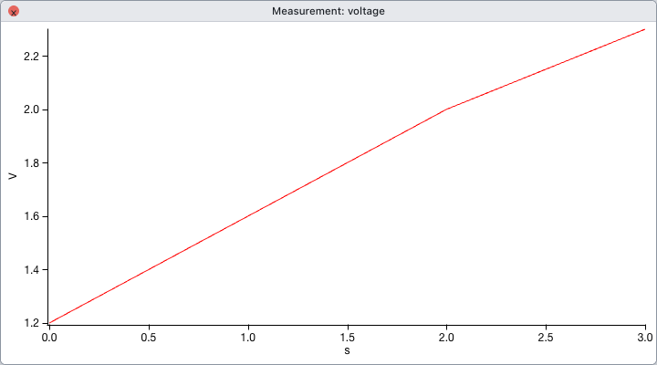

import { Code } from "@astrojs/starlight/components";
import OpenApp from "../../../../components/OpenApp.astro";
import code from "../../../../snippets/import-csv.py?raw";

<OpenApp />

1. Save the following as `measurement.csv`. Drop it on the app or choose **File → Load Delimited Text…**.

   ```csv
   time (s),voltage (V)
   0,1.2
   1,1.6
   2,2.0
   3,2.3
   ```

2. In **Load Data**, check that the delimiter is a comma and the first row provides the column names. Loading creates one wave for each column and displays them in a table.

3. The script below loads the same data directly from bytes and plots voltage against time. Use a fresh experiment to keep the scripted import separate from the menu import.

<Code code={code.trimEnd()} lang="python" locale="en" />



`op.display(v, x=t)` uses the actual time values, including when the measurements are unevenly spaced. See [import and export](../../guides/import-export/) for column types and missing values.
