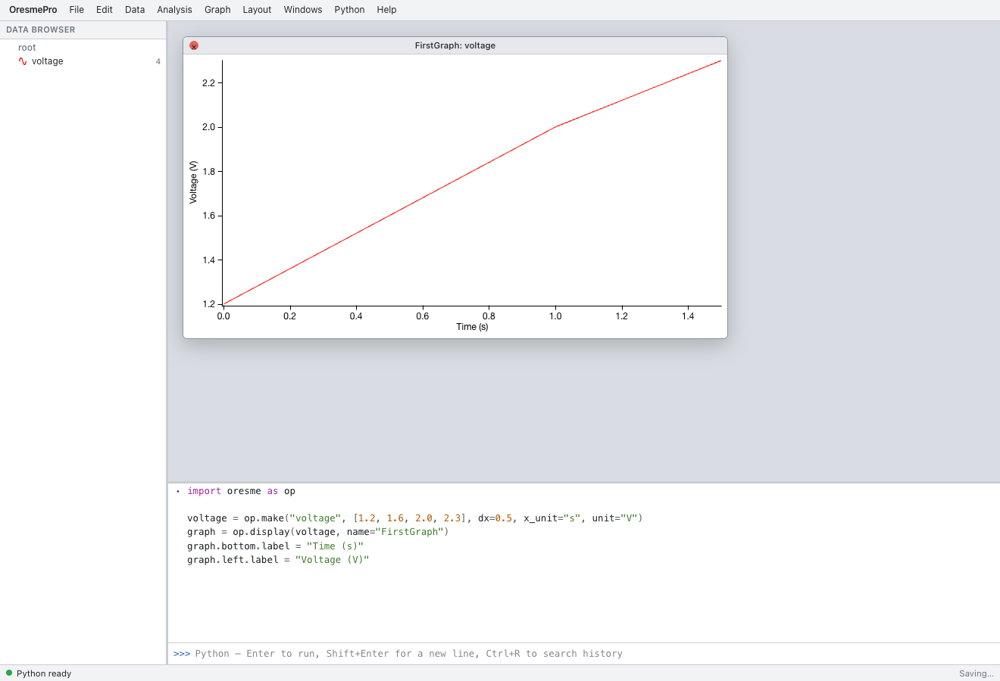

import OpenApp from "../../../../components/OpenApp.astro";
import { Code, Steps } from "@astrojs/starlight/components";

OresmePro is a browser workspace for working with experimental data in tables, graphs, and analyses. It stores data as named arrays called **waves**. You can operate on the same waves and graphs through the interface or the built-in Python session.

import code from "../../../../snippets/first-graph.py?raw";

<OpenApp />

<Steps>

1. Open OresmePro and wait for **Python ready** in the status bar. To run locally, execute these commands at the repository root and open the URL printed in your terminal.

   ```sh
   pnpm install --frozen-lockfile
   pnpm dev
   ```

2. Use the **Command Window** at the bottom. If it is hidden, choose **Windows → Command Window**. The **Data Browser** on the left lists waves, folders, and analysis results. Graphs and tables open on the desktop. The Command Window shows history above the input field.

3. If you have an experiment in progress, choose **File → New Experiment**. Paste the code below into the input field and press **Enter**. Use **Shift+Enter** for a newline and **Ctrl+Enter** (**⌘+Enter** on macOS) to run the entire input.

   <Code code={code.trimEnd()} lang="python" locale="en" />

4. Look for `voltage` in the **Data Browser** and four points in **FirstGraph**. With no X wave supplied, the plot uses the wave's `dx=0.5` scale, giving X coordinates of 0, 0.5, 1, and 1.5 seconds.

</Steps>



To create an empty wave through the menus, choose **Data → Make Waves…**. To create a graph, choose **Windows → New Graph…**. For a file of your own, continue to [importing CSV data](./import-csv/).
