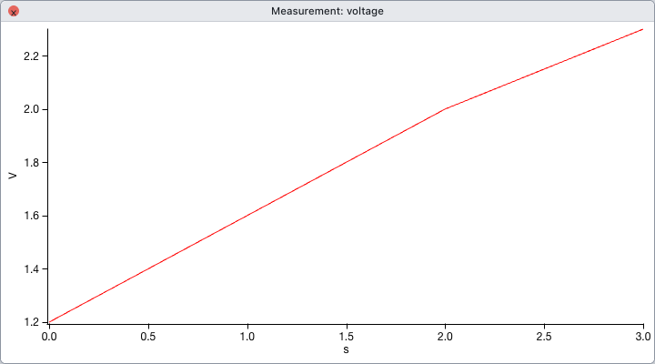

import { Code } from "@astrojs/starlight/components";
import OpenApp from "../../../components/OpenApp.astro";
import code from "../../../snippets/import-csv.py?raw";

<OpenApp />

1. 次の内容を `measurement.csv` として保存し、OresmePro にドロップするか **File → Load Delimited Text…** で開きます。

   ```csv
   time (s),voltage (V)
   0,1.2
   1,1.6
   2,2.0
   3,2.3
   ```

2. **Load Data** のプレビューで区切り文字がカンマ、先頭行が列見出しになっていることを確認します。読み込むと2列がそれぞれ Wave になり、テーブルに表示されます。

3. 下のコードは、同じデータをファイルを作らずに読み込んで、時刻を X、電圧を Y にしたグラフを作ります。新しい Experiment で実行すると、画面で読み込んだデータと区別しやすくなります。

<Code code={code.trimEnd()} lang="python" locale="ja" />



X の測定間隔が不規則な CSV でも、`op.display(v, x=t)` は時刻列の値をそのまま使います。列型や欠損値の確認方法は [インポートとエクスポート](../../guides/import-export/) を参照してください。
