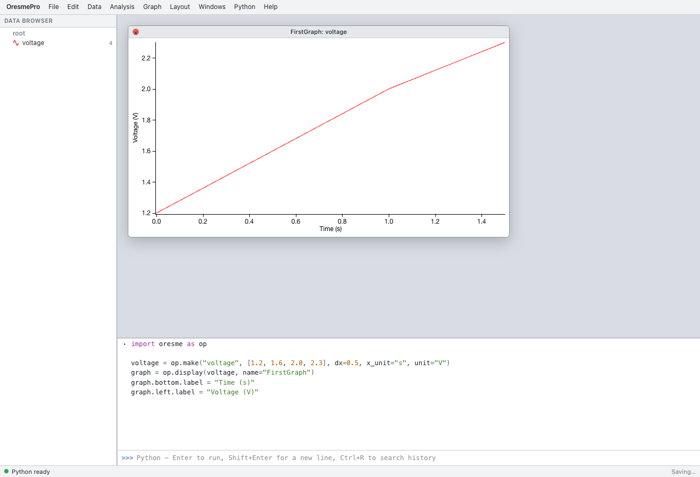

import OpenApp from "../../../components/OpenApp.astro";
import { Code, Steps } from "@astrojs/starlight/components";

OresmePro は、実験データの表・グラフ・解析をブラウザー内で扱う作業環境です。データは **Wave** という名前付きの配列に保存されます。画面から操作するほか、アプリに組み込まれた Python から同じ Wave やグラフを操作できます。

import code from "../../../snippets/first-graph.py?raw";

<OpenApp />

<Steps>

1. ブラウザーで OresmePro を開き、ステータスバーに **Python ready** が表示されるまで待ちます。ローカルで起動する場合はリポジトリのルートで次を実行し、ターミナルに表示された URL を開きます。

   ```sh
   pnpm install --frozen-lockfile
   pnpm dev
   ```

2. 下側の **Command Window** を使います。表示されていない場合は **Windows → Command Window** で開きます。左の **Data Browser** には Wave、フォルダ、解析結果などが並び、デスクトップ上にはグラフやテーブルが開きます。コマンドウィンドウは上側が実行履歴、下側が入力欄です。

3. 作業中のデータがある場合は **File → New Experiment** を選びます。下のコードを入力欄に貼り付けて **Enter** を押します。**Shift+Enter** で改行し、**Ctrl+Enter**（macOS では **⌘+Enter**）で入力全体を実行できます。

   <Code code={code.trimEnd()} lang="python" locale="ja" />

4. **Data Browser** に `voltage` が現れ、**FirstGraph** に4点が描かれます。X Wave を指定していないため、横座標は `dx=0.5` に従い、0、0.5、1、1.5 秒です。

</Steps>



画面で空の Wave を作るには **Data → Make Waves…**、グラフを作るには **Windows → New Graph…** を使います。手元のファイルがある場合は [CSV の読み込み](./import-csv/) に進めます。
